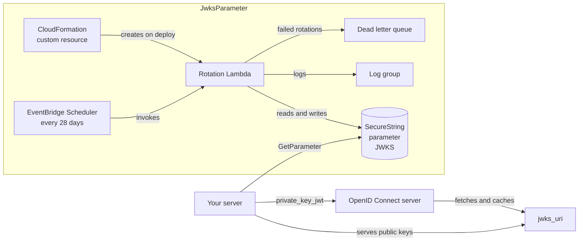

# cdk-jwks-parameter

[](https://github.com/justin-tay/cdk-jwks-parameter/actions/workflows/ci.yml)
[](https://www.npmjs.com/package/cdk-jwks-parameter)
[](LICENSE)

An AWS CDK construct for a JWK Set stored in an SSM Parameter Store
`SecureString` and rotated by a Lambda that EventBridge Scheduler invokes. The
parameter is created with 2 keys when the stack is deployed. Every 28 days a new
key is added, keeping at most 3, so that a key is published before it is used,
e.g. for `private_key_jwt` client authentication with an OpenID Connect server.

It is the Parameter Store counterpart of
[`cdk-jwks-secret`](https://github.com/justin-tay/cdk-jwks-secret), and exists
for one reason: **cost**. A standard parameter is free, where a Secrets Manager
secret costs $0.40 per month. In exchange you lose Secrets Manager's staged
rotation and rotation lock; see [Compared with `cdk-jwks-secret`](#compared-with-cdk-jwks-secret).
If the cost doesn't matter to you, use `cdk-jwks-secret`.

| **Reference documentation** |                                                                                                                                          |
| --------------------------- | ---------------------------------------------------------------------------------------------------------------------------------------- |
| Parameter Store             | [AWS Systems Manager Parameter Store](https://docs.aws.amazon.com/systems-manager/latest/userguide/systems-manager-parameter-store.html) |
| `private_key_jwt`           | [OpenID Connect Core 1.0, section 9](https://openid.net/specs/openid-connect-core-1_0.html#ClientAuthentication)                         |
| JSON Web Key (JWK)          | [RFC 7517](https://www.rfc-editor.org/rfc/rfc7517)                                                                                       |
| JSON Web Algorithms (JWA)   | [RFC 7518](https://www.rfc-editor.org/rfc/rfc7518)                                                                                       |
| JWK thumbprint (`kid`)      | [RFC 7638](https://www.rfc-editor.org/rfc/rfc7638)                                                                                       |
| Guides                      | [How rotation works](docs/how-rotation-works.md), [Using the keys](docs/using-the-keys.md), [Logging](docs/logging.md)                   |

## Overview

Install the package; `aws-cdk-lib` and `constructs` are peer dependencies:

```sh
npm install cdk-jwks-parameter
```

Then add a `JwksParameter` to a stack:

```ts
import { JwksParameter } from 'cdk-jwks-parameter';

const jwksParameter = new JwksParameter(this, 'ClientJwks', {
  use: 'sig', // default; ES256 keys. Use 'enc' for ECDH-ES+A128KW keys.
});

jwksParameter.grantRead(serverTaskRole);
```

Your server reads the parameter, serves its public keys from the client's
`jwks_uri` and signs (or decrypts) with the private keys; see
[Using the keys](docs/using-the-keys.md).

> **Cost:** an `ES*` or `ECDH-ES*` JWKS fits a standard parameter, which is
> free. Larger RSA keys need the advanced tier, at
> [$0.05 per month](https://aws.amazon.com/systems-manager/pricing/). The
> construct picks the tier; see [Parameter tier](#parameter-tier).

## Construct Props

| **Name**               | **Type**                                                                         | **Default**                                                                                             | **Description**                                                                                                                                                                                                                                                                                                                |
| ---------------------- | -------------------------------------------------------------------------------- | ------------------------------------------------------------------------------------------------------- | ------------------------------------------------------------------------------------------------------------------------------------------------------------------------------------------------------------------------------------------------------------------------------------------------------------------------------ |
| use?                   | `JwkPublicKeyUse`                                                                | The use of `algorithm`, or `'sig'`                                                                      | Whether the keys sign (`'sig'`, e.g. for `private_key_jwt`) or encrypt (`'enc'`, e.g. for encrypted ID tokens). Selects the default algorithm. If `algorithm` is also given, it must have this use.                                                                                                                            |
| algorithm?             | `JwkAlgorithm`                                                                   | `'ES256'` for `sig`, `'ECDH-ES+A128KW'` for `enc`                                                       | The JWA algorithm of every key. For `sig` keys: `RS256` `RS384` `RS512` `PS256` `PS384` `PS512` `ES256` `ES384` `ES512`. For `enc` keys: `RSA-OAEP-256` `ECDH-ES` `ECDH-ES+A128KW` `ECDH-ES+A192KW` `ECDH-ES+A256KW`. Determines the key type, the use and, for `ES*`, the curve.                                              |
| curve?                 | `JwkEcCurve`                                                                     | Implied by `algorithm`; `P-256` for `ECDH-ES*`                                                          | The EC curve: `P-256`, `P-384` or `P-521`. Can only be chosen for `ECDH-ES` and `ECDH-ES+A*KW`. For `ES*` it must match the algorithm.                                                                                                                                                                                         |
| rsaModulusLength?      | `number`                                                                         | `2048`                                                                                                  | The RSA modulus length in bits, a multiple of 8 from 2048 to 4096. For RSA algorithms only. Larger keys may need the advanced tier, or not fit; see [Parameter tier](#parameter-tier).                                                                                                                                         |
| parameterProps?        | `{ parameterName?, description?, encryptionKey?, removalPolicy? }`               | `/` and the construct path, no description, the AWS managed key `alias/aws/ssm`, `RemovalPolicy.RETAIN` | Overrides for the parameter. Its value is always managed by the construct. It is retained by default because deleting it loses the keys the client registration relies on; see [Removal and cost](#removal-and-cost). The name cannot change without creating a new parameter.                                                 |
| rotationLambdaProps?   | `Pick<FunctionProps, 'memorySize' \| 'vpc' \| 'vpcSubnets' \| 'securityGroups'>` | Not in a VPC. `memorySize` is 512 for RSA keys larger than 2048 bits, 128 otherwise.                    | Overrides for the rotation Lambda. Lambda allocates CPU in proportion to memory, which RSA key generation needs. In a VPC, the subnets need a route to Systems Manager through a VPC endpoint or NAT.                                                                                                                          |
| rotationLogGroupProps? | `Pick<LogGroupProps, 'retention' \| 'removalPolicy' \| 'encryptionKey'>`         | `RetentionDays.ONE_YEAR`, no customer managed key and the parameter's removal policy                    | Overrides for the rotation Lambda's log group, which holds the [ECS logs](docs/logging.md).                                                                                                                                                                                                                                    |
| rotationScheduleProps? | `{ automaticallyAfter?: Duration }`                                              | `automaticallyAfter: Duration.days(28)`                                                                 | Overrides for the rotation schedule. `automaticallyAfter` must be from 4 hours to 1000 days. It is also how long a new key is published before it is used, so it should be longer than the OpenID Connect server's JWKS cache lifetime. A scheduled rotation is skipped if the parameter changed less than half this long ago. |

The key options (`use`, `algorithm`, `curve`, `rsaModulusLength`) cannot be
changed on an existing parameter: the deployment and the next rotation fail and
leave the parameter unchanged. See
[Changing the key options](docs/how-rotation-works.md#changing-the-key-options).

## Construct Properties

| **Name**                | **Type**                    | **Description**                                                                                                                                      |
| ----------------------- | --------------------------- | ---------------------------------------------------------------------------------------------------------------------------------------------------- |
| parameterName           | `string`                    | The name of the parameter.                                                                                                                           |
| parameterArn            | `string`                    | The ARN of the parameter.                                                                                                                            |
| tier                    | `'Standard' \| 'Advanced'`  | The parameter tier the key options need.                                                                                                             |
| initialisation          | `CustomResource`            | The custom resource that creates the parameter. Depend on it to read the parameter during the deployment.                                            |
| rotationSchedule        | `scheduler.Schedule`        | The EventBridge Scheduler schedule that rotates the parameter.                                                                                       |
| rotationLambda          | `lambda.Function`           | The rotation Lambda. Alarm on `metricErrors()`.                                                                                                      |
| rotationLogGroup        | `logs.LogGroup`             | The rotation Lambda's log group.                                                                                                                     |
| rotationLambdaRole      | `iam.Role`                  | The rotation Lambda's execution role.                                                                                                                |
| rotationDeadLetterQueue | `sqs.Queue`                 | Receives a scheduled rotation that still failed after Lambda's 2 retries.                                                                            |
| jwkOptions              | `ResolvedJwkOptions`        | The resolved key options: `algorithm`, `use`, `keyType`, and `curve` or `rsaModulusLength`.                                                          |
| grantRead(grantee)      | method, returns `iam.Grant` | Grants `grantee` `ssm:GetParameter` on the parameter (and decrypt on `encryptionKey`), e.g. the server that serves the JWKS and signs with the keys. |

## Parameter tier

Parameter Store holds 4 KB in a standard parameter and 8 KB in an advanced one.
The construct works out the largest JWKS the key options can produce (`sig`
keeps 2 private keys and 1 public key; `enc` keeps 3 private keys) and picks the
cheapest tier that holds it:

| **Keys**                      | **Largest JWKS** | **Tier**              | **Cost**                                                               |
| ----------------------------- | ---------------- | --------------------- | ---------------------------------------------------------------------- |
| `ES*`, `ECDH-ES*` (any curve) | under 1.2 KB     | Standard              | Free                                                                   |
| `RS*`, `PS*` 2048 bits        | about 3.85 KB    | Standard              | Free                                                                   |
| `RSA-OAEP-256` 2048 bits      | about 5.1 KB     | Advanced              | [$0.05 per month](https://aws.amazon.com/systems-manager/pricing/)     |
| `RS*`, `PS*` 3072 bits        | about 5.6 KB     | Advanced              | $0.05 per month                                                        |
| `RS*`, `PS*` 4096 bits        | about 7.3 KB     | Advanced              | $0.05 per month                                                        |
| `RSA-OAEP-256` 3072 bits      | about 7.4 KB     | Advanced              | $0.05 per month                                                        |
| `RSA-OAEP-256` 4096 bits      | about 9.7 KB     | None: synthesis fails | Use [`cdk-jwks-secret`](https://github.com/justin-tay/cdk-jwks-secret) |

The sizes are estimates from the JSON the function writes; `maxJwksBytes` in
`cdk-jwks-parameter/jwks` computes them. A 2048-bit `RS256` JWKS is within about 250
bytes of the standard limit. The tier is derived from the options, so a
rotation cannot outgrow it.

## AWS resources

`JwksParameter` creates:

| **AWS resource**                                                  | **CloudFormation type**                               | **Purpose**                                                                                     | **Cost**                                                                                     |
| ----------------------------------------------------------------- | ----------------------------------------------------- | ----------------------------------------------------------------------------------------------- | -------------------------------------------------------------------------------------------- |
| Parameter (created by the custom resource, not by CloudFormation) | `AWS::SSM::Parameter` (not a CloudFormation resource) | Holds the JWKS as a `SecureString`. **Retained** by default.                                    | Standard: free. Advanced: [$0.05 per month](https://aws.amazon.com/systems-manager/pricing/) |
| Custom resource                                                   | `Custom::JwksParameter`                               | Has the rotation Lambda create the parameter when the stack is deployed                         | Free                                                                                         |
| Rotation schedule                                                 | `AWS::Scheduler::Schedule`                            | Invokes the rotation Lambda every 28 days                                                       | [14 million invocations per month are free](https://aws.amazon.com/eventbridge/pricing/)     |
| Scheduler role                                                    | `AWS::IAM::Role`, `AWS::IAM::Policy`                  | Lets EventBridge Scheduler invoke the rotation Lambda only                                      | Free                                                                                         |
| Rotation Lambda                                                   | `AWS::Lambda::Function`                               | Creates the parameter and generates and rotates the keys                                        | [Per invocation](https://aws.amazon.com/lambda/pricing/); a few seconds per rotation         |
| Lambda event invoke config                                        | `AWS::Lambda::EventInvokeConfig`                      | 2 retries of a failed rotation                                                                  | Free                                                                                         |
| Lambda role                                                       | `AWS::IAM::Role`, `AWS::IAM::Policy`                  | Lets the rotation Lambda read and write its parameter, write its logs and the dead letter queue | Free                                                                                         |
| Dead letter queue                                                 | `AWS::SQS::Queue`, `AWS::SQS::QueuePolicy`            | Receives a rotation that failed after its retries, kept 14 days                                 | [Free tier of 1 million requests](https://aws.amazon.com/sqs/pricing/)                       |
| Log group                                                         | `AWS::Logs::LogGroup`                                 | Rotation Lambda logs, kept 1 year. **Retained** by default.                                     | [Storage](https://aws.amazon.com/cloudwatch/pricing/); a few KB per rotation                 |
| Security group (with `rotationLambdaProps.vpc` only)              | `AWS::EC2::SecurityGroup`                             | Network access for the rotation Lambda in the VPC                                               | Free                                                                                         |
| Key policy statements (with `parameterProps.encryptionKey` only)  | modifies your `AWS::KMS::Key`                         | Let the rotation Lambda use the key                                                             | None beyond [the key's own cost](https://aws.amazon.com/kms/pricing/)                        |

Unlike `cdk-jwks-secret`'s secret, the parameter is not a CloudFormation
resource: CloudFormation cannot create a `SecureString`, so a custom resource
backed by the rotation Lambda creates it. The Lambda is invoked directly (no
provider framework, so no extra Lambda in your stack) and a deployment waits at
most 2 minutes for it.

## Default settings

Out of the box implementation of the Construct without any override will set
the following defaults:

### SSM parameter

- A `SecureString` created with 2 keys by the custom resource; no key material
  passes through CloudFormation
- Standard tier for `ES*`, `ECDH-ES*` and 2048-bit `RS*`/`PS*` keys, advanced
  otherwise
- Encrypted with the AWS managed key `alias/aws/ssm`
- Named `/<construct path>`, e.g. `/MyStack/ClientJwks`
- Retained when removed from the stack; with `RemovalPolicy.DESTROY` the Lambda
  deletes it

### Rotation schedule

- `rate(28 days)`, with no flexible time window
- EventBridge Scheduler fires a new schedule shortly after it is created (about
  45 seconds in a test deployment). That invocation finds the parameter just
  created and is skipped, as is any rotation within half an interval of the
  last change
- Each rotation adds a new private key, keeps at most 3 keys and, for `sig`
  keys, removes the private part of the oldest key

### AWS Lambda function (rotation)

- Node.js 24 on arm64, 1 minute timeout
- Reserved concurrency of 1, so two rotations never run at once
- 128 MB memory, or 512 MB for RSA keys larger than 2048 bits, which take far more CPU to generate
- Code pre-bundled in the package; nothing is bundled when the consumer synthesizes
- Retries a failed rotation twice, then sends it to the dead letter queue
- Logs each event as [ECS](docs/logging.md) JSON records, with key ids only, never key material
- Not in a VPC

### AWS IAM roles and policies

- Execution role without AWS managed policies
- Allows `logs:CreateLogStream` and `logs:PutLogEvents` on the rotation Lambda's own log group only
- Allows `ssm:GetParameter` and `ssm:PutParameter` on the parameter only, and
  `ssm:DeleteParameter` with `RemovalPolicy.DESTROY`
- Allows `sqs:SendMessage` on the dead letter queue
- A scheduler role that allows `lambda:InvokeFunction` on the rotation Lambda only

### Amazon CloudWatch Logs log group

- Holds the rotation Lambda's logs for 1 year, encrypted with `rotationLogGroupProps.encryptionKey` if given
- Retained when removed from the stack

### Optional resources

- With `rotationLambdaProps.vpc`: a security group for the rotation Lambda (unless `securityGroups` is given), allowing all outbound traffic, and the `AWSLambdaVPCAccessExecutionRole` managed policy on its role
- With `parameterProps.encryptionKey`: key policy statements allowing the rotation Lambda `kms:Encrypt` and `kms:Decrypt`

## cdk-nag

The construct passes the [cdk-nag](https://github.com/cdklabs/cdk-nag)
`AwsSolutionsChecks` rules. It acknowledges findings on the roles it creates
with CDK's `Validations.of(...).acknowledge(...)`, so they appear as
acknowledged, with these reasons, in your validation report:

| **Finding**                                                                                         | **Reason**                                                                                                           |
| --------------------------------------------------------------------------------------------------- | -------------------------------------------------------------------------------------------------------------------- |
| `AwsSolutions-IAM5[Resource::<RotationLambda.Arn>:*]` (scheduler role)                              | The scheduler role may invoke only the rotation Lambda and its versions and aliases, which the `:*` resource covers. |
| `AwsSolutions-IAM4[Policy::…AWSLambdaVPCAccessExecutionRole]` (with `rotationLambdaProps.vpc` only) | Lambda needs these network interface permissions to run in a VPC; they do not support resource-level permissions.    |

cdk-nag identifies these findings only by rule and policy, not by statement,
so the acknowledgements cover the whole role. Don't add your own permissions to
`rotationLambdaRole`: a wildcard permission you add would be acknowledged with
these reasons instead of being reported.

## Architecture



## Compared with `cdk-jwks-secret`

The key lifecycle, algorithms, validation and `/jwks` helpers are the same. The
storage and the rotation machinery differ:

| **Topic**               | **`cdk-jwks-secret`** (Secrets Manager)               | **`cdk-jwks-parameter`** (Parameter Store)                                  |
| ----------------------- | ----------------------------------------------------- | --------------------------------------------------------------------------- |
| Cost of the store       | $0.40 per month                                       | Free (standard), $0.05 per month (advanced)                                 |
| Rotation                | Native, 4 staged steps with a pending version         | EventBridge Scheduler, a single validated write                             |
| Concurrent rotations    | Prevented by Secrets Manager                          | Prevented by reserved concurrency 1 and a minimum age                       |
| Initialisation          | Rotation on creation of the schedule                  | A custom resource creates the parameter                                     |
| A schedule change       | Rotates immediately                                   | Does not rotate                                                             |
| Old versions            | Only those with a staging label are kept              | Kept (up to 100) and readable by anyone with `ssm:GetParameter`             |
| Size limit              | 64 KB                                                 | 4 KB (standard) or 8 KB (advanced): RSA-OAEP-256 4096-bit keys do not fit   |
| Rotation failure signal | Secrets Manager rotation status and `LastRotatedDate` | Lambda errors, the dead letter queue and the [logs](docs/logging.md#alarms) |

## Removal and cost

By default the parameter and the rotation Lambda's log group are **retained**
when they are removed from the stack or the stack is destroyed, because
deleting the parameter loses the keys the client registration relies on.

A retained advanced parameter keeps costing $0.05 per month until it is deleted,
although it no longer rotates (the schedule is removed with the stack). A
retained standard parameter is free. Delete it with:

```sh
aws ssm delete-parameter --name <parameter-name>
```

For development and test stacks, pass
`parameterProps: { removalPolicy: RemovalPolicy.DESTROY }` instead; the log
group follows it, and the rotation Lambda's role is allowed `ssm:DeleteParameter`.

Deploying the stack again over a retained parameter adopts it, provided its
keys have the configured options.

## Guides

- [How rotation works](docs/how-rotation-works.md): the key lifecycle for `sig` and `enc` keys, what the Lambda does and what differs from Secrets Manager
- [Using the keys](docs/using-the-keys.md): what your server must do to serve the JWKS endpoint and sign or decrypt, the `cdk-jwks-parameter/jwks` helpers, and the old versions Parameter Store keeps
- [Logging](docs/logging.md): the ECS event schema and reference, and how to query and alarm on the logs

## Example

The repository's [`bin/`](bin) folder contains a deployable example app,
`JwksParameterExampleApp`, for an OpenID Connect client that both signs and
decrypts:

- a `sig` `JwksParameter` (`ES256`) and an `enc` `JwksParameter` (`ECDH-ES+A128KW`),
  both destroyed with the stack
- a JWKS endpoint Lambda behind a public Function URL that serves the public
  keys of both parameters in one JWKS, as a client's `jwks_uri` would

So that a rotation shows up straight away, the example doesn't cache the
parameters by default; a real endpoint would cache them for a few minutes.

On top of the resources of the two `JwksParameter`s, it creates:

| **AWS resource**         | **CloudFormation type**              | **Purpose**                                                  | **Cost**                                              |
| ------------------------ | ------------------------------------ | ------------------------------------------------------------ | ----------------------------------------------------- |
| Endpoint Lambda          | `AWS::Lambda::Function`              | Serves the public keys of both parameters                    | [Per request](https://aws.amazon.com/lambda/pricing/) |
| Function URL             | `AWS::Lambda::Url`                   | Public HTTPS address of the endpoint (output `JwksUrl`)      | Free                                                  |
| Function URL permissions | `AWS::Lambda::Permission` (2)        | Allow anyone to invoke the endpoint through the Function URL | Free                                                  |
| Endpoint role            | `AWS::IAM::Role`, `AWS::IAM::Policy` | Lets the endpoint read both parameters                       | Free                                                  |
| Endpoint log group       | `AWS::Logs::LogGroup`                | The endpoint's logs, kept 1 week                             | [Storage](https://aws.amazon.com/cloudwatch/pricing/) |

The example's parameters and all its log groups (kept 1 week) are destroyed with
the stack, so `cdk destroy` leaves nothing behind.

To try it, clone the repository and deploy it to the AWS account and region of
your current credentials:

```sh
npm ci
npm run cdk:deploy                    # outputs JwksUrl, SigParameterName, EncParameterName and the rotation Lambdas
curl <JwksUrl>                        # 2 sig + 2 enc keys, as soon as the deployment completes
aws lambda invoke --function-name <SigRotationLambda> --cli-binary-format raw-in-base64-out \
  --payload '{"action":"rotate","force":true}' response.json
curl <JwksUrl>                        # 3 sig + 2 enc keys
npm run cdk:destroy
```

Choose the algorithms, rotation interval and endpoint cache duration with CDK
context, e.g.
`npm run cdk:deploy -- -c sigAlgorithm=PS256 -c encAlgorithm=RSA-OAEP-256 -c rotationIntervalDays=1 -c jwksCacheSeconds=300`.

## Contributing

Bug reports and pull requests are welcome. See [CONTRIBUTING.md](CONTRIBUTING.md)
for how to build and test the project, and [SECURITY.md](SECURITY.md) for
reporting vulnerabilities.

## License

[MIT](LICENSE)
